  

<!-- DOOMSDAY_STATUS:START -->
> **Active Sector Lead:** `DR. DOOM` · Last summoned by `@loucasty-cell`
<!-- DOOMSDAY_STATUS:END -->

<!-- INTERACTIVE DRAWER: DOOMSDAY ROSTER -->

  
<b>▸ Summon / Inspect Doomsday Roster (9 Entities)</b> <i>(click to interact)</i>

   

  Click any **Summon** trigger to open a pre-filled issue—submitting it runs a GitHub Action that updates the live Active Sector Lead above and closes the issue automatically.

  | Character | Motion on Stage | Interactive Trigger |
  | :--- | :--- | :--- |
  | **Dr. Doom** | Center levitation + emerald energy pulse | [Summon Doom](https://github.com/loucasty-cell/loucasty-cell/issues/new?title=summon%3A+dr-doom&body=Just+click+Submit+to+put+Dr.+Doom+on+lead+command.) |
  | **Iron Man** | Repulsor flight patrol + jet flicker | [Summon Iron Man](https://github.com/loucasty-cell/loucasty-cell/issues/new?title=summon%3A+iron-man&body=Just+click+Submit+to+summon+Iron+Man.) |
  | **Spider-Man** | Ceiling web-line pendulum swing | [Summon Spider-Man](https://github.com/loucasty-cell/loucasty-cell/issues/new?title=summon%3A+spider-man&body=Just+click+Submit+to+summon+Spider-Man.) |
  | **Thor** | Hovering Mjolnir + lightning flashes | [Summon Thor](https://github.com/loucasty-cell/loucasty-cell/issues/new?title=summon%3A+thor&body=Just+click+Submit+to+summon+Thor.) |
  | **Dr. Strange** | Levitation + spinning Eldritch ring | [Summon Dr. Strange](https://github.com/loucasty-cell/loucasty-cell/issues/new?title=summon%3A+dr-strange&body=Just+click+Submit+to+summon+Dr.+Strange.) |
  | **Captain America** | Floor patrol + Vibranium shield | [Summon Cap](https://github.com/loucasty-cell/loucasty-cell/issues/new?title=summon%3A+cap&body=Just+click+Submit+to+summon+Captain+America.) |
  | **Hulk** | Heavy leap stomp + floor shockwave | [Summon Hulk](https://github.com/loucasty-cell/loucasty-cell/issues/new?title=summon%3A+hulk&body=Just+click+Submit+to+summon+Hulk.) |
  | **Black Panther** | Agile vibranium floor dash | [Summon Panther](https://github.com/loucasty-cell/loucasty-cell/issues/new?title=summon%3A+black-panther&body=Just+click+Submit+to+summon+Black+Panther.) |
  | **Loki** | Trickster illusion phase-teleport | [Summon Loki](https://github.com/loucasty-cell/loucasty-cell/issues/new?title=summon%3A+loki&body=Just+click+Submit+to+summon+Loki.) |

 

Engineering student building **domain-specific interfaces, spatial telemetry dashboards, and ReAct agent pipelines**. I prioritize functional density over generic landing-page bloat—systems inspired by mission consoles, designed with tactile minimalism.

  

### Active Builds

| Project | Domain | Architecture & Stack | Status |
| :--- | :--- | :--- | :--- |
| **[bookflow](https://github.com/loucasty-cell/bookflow)** | Agentic Reasoning | ReAct (Reasoning + Acting) prompting loop, web client | `ACTIVE` |
| **AgriQill / AgroGuard** | Spatial GIS & IoT | Isometric digital twin, custom `.agri` DSL linter, FastAPI, LoRaWAN, Open-Meteo | `IN PROGRESS` |
| **Petey Plant** | Applied Vision / Agents | Agentic plant diagnostics, PlantNet-300K, PyTorch, React, Three.js | `PROTOTYPE` |
| **[CrisisGuardAI](https://github.com/loucasty-cell/CrisisGuardAI)** | Applied AI / Decision Support | AI crisis triage engine, disaster telemetry dispatch, NLP, TypeScript | `ACTIVE` |

  

<!-- INTERACTIVE DRAWER 1: ARCHITECTURE & STACK -->

  
<b>▸ Inspect Stack &amp; Engineering Niches</b> <i>(click to expand)</i>

   

  <table>
    <tr>
      <td valign="top" width="25%">
        <b>Machine Learning &amp; Vision</b>  
        <code>PyTorch</code> · <code>Scikit-Learn</code> 
        <code>Vision Transformers (ViT)</code> 
        <code>PlantNet-300K</code> · <code>OpenCV</code> 
        <code>Model Fine-Tuning</code>
      </td>
      <td valign="top" width="25%">
        <b>Agentic Systems &amp; NLP</b>  
        <code>ReAct Loops</code> · <code>Tool Calling</code> 
        <code>Context Engineering</code> 
        <code>Decision Support Systems</code> 
        <code>Prompt Optimization</code>
      </td>
      <td valign="top" width="25%">
        <b>Interfaces &amp; Spatial 3D</b>  
        <code>React 19</code> · <code>TypeScript</code> 
        <code>Tailwind v4</code> · <code>Figma</code> 
        <code>Three.js</code> · <code>WebGL Shaders</code> 
        <code>MapLibre</code> · <code>Deck.gl GIS</code>
      </td>
      <td valign="top" width="25%">
        <b>Systems, Engines &amp; Core</b>  
        <code>FastAPI</code> · <code>Java (Spring/OOP)</code> 
        <code>Luau</code> · <code>Roblox Engine (Rojo)</code> 
        <code>Linux VMs</code> · <code>Custom DSL Linters</code> 
        <code>Digital Hardware &amp; Prolog</code>
      </td>
    </tr>
  </table>

   

  #### 🛰️ Core Engineering Niches
  - **Applied Computer Vision & Fine-Tuning**: Training and evaluating visual diagnostic models (transfer learning on PlantNet-300K, feature extractors) with PyTorch pipelines for field edge inference.
  - **ReAct & Autonomous Agent Systems**: Implementing verifiable Reasoning + Acting agent loops with strict tool execution, sandboxed fallbacks, and deterministic telemetry.
  - **Spatial Telemetry & Digital Twins**: Bridging physical IoT feeds (LoRaWAN, sensor streams) with high-density GIS map projections (`Deck.gl`, `MapLibre`) and real-time isometric visualizations.
  - **Domain-Specific Languages (DSLs) & Compilers**: Engineering custom grammar parsers, AST linting engines (e.g., `.agri` specs), and strict Luau type-system architectures.

<!-- INTERACTIVE DRAWER 2: DESIGN PRINCIPLES -->

  
<b>▸ Anti-Slop Design Rules</b> <i>(how I ship software)</i>

   

  1. **Hierarchy before decoration** — If every card screams with gradients and shadows, nothing is readable.
  2. **Tables beat card soup** — Structured data belongs in scannable rows and columns.
  3. **Motion earns its pixels** — Subtle state cues (`120–250ms` or calm ambient loops) only; never theatrical clutter.
  4. **First-principles prototyping** — Local environments, real datasets, zero fake telemetry.

  

### Contribution Telemetry

  <picture>
    <source media="(prefers-color-scheme: dark)" srcset="https://raw.githubusercontent.com/loucasty-cell/loucasty-cell/output/snake-cacao.svg" />
    <source media="(prefers-color-scheme: light)" srcset="https://raw.githubusercontent.com/loucasty-cell/loucasty-cell/output/snake-cacao.svg" />
    
  </picture>

 

<!-- INTERACTIVE DRAWER 3: VISITOR CONSOLE -->

  
<b>▸ Interactive Desk Console</b> <i>(leave a ping or refill espresso)</i>

   

  Click below to open a pre-filled issue on this profile repository:

  

    
    &nbsp;
    
  

  

  <a href="https://github.com/loucasty-cell?tab=repositories"><code>Repositories</code></a> ·
  <a href="https://github.com/loucasty-cell?tab=stars"><code>Stars</code></a> ·
  <a href="https://loucasty-cell.github.io/loucasty-cell/"><code>3D Pet Console</code></a> ·
  <a href="mailto:linnhtetaung@uit.edu.mm"><code>Email</code></a>

